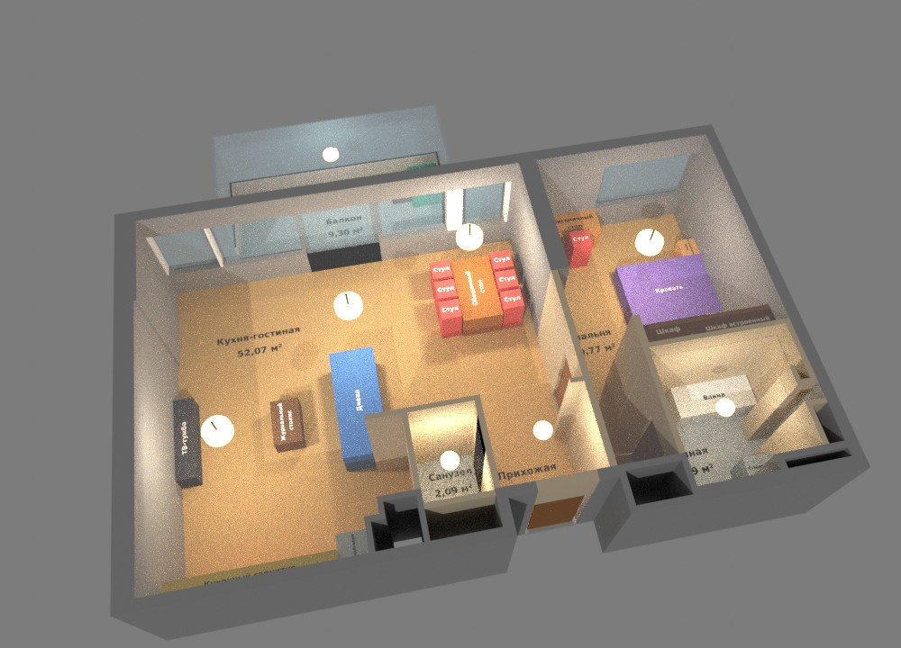
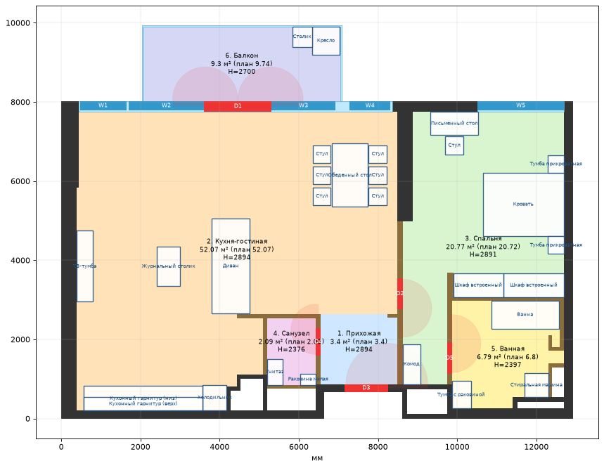

# floorplan — планировка из PDF → 3D → мебель → объёмы → Excel

Тестовое задание «автоматизация строительных смет»: первая часть пути
«2D-планировка → 3D-модель → мебель → объёмы → смета».





## Запуск

```bash
uv venv .venv
uv pip install -p .venv pymupdf shapely openpyxl matplotlib numpy trimesh mapbox-earcut ifcopenshell
.venv/bin/python -m floorplan input/projectfortest.pdf --corrections input/corrections.json --prices input/prices.json --out out
blender out/apartment.blend        # открыть модель
```

Нужен установленный Blender (проверено на 4.0): конвейер сам запускает его без
интерфейса и собирает сцену. Без Blender (`--blender ""`) получатся все файлы,
кроме `.blend` и рендера.

## Что получается (`out/`)

| Файл | Что это |
|---|---|
| `volumes.xlsx` | объёмы: лист «Объёмы» в формате ТЗ, «Смета» (объёмы × примерные цены, итог формулами), плюс «Сводка», «Проёмы», «Мебель», «Проверка», «Допущения» |
| `apartment.blend` | 3D-модель — сцена Blender: объекты с именами по коллекциям «Полы», «Стены», «Окна», «Двери», «Потолки», «Освещение», «Мебель», подписи; мебель разных цветов, с надписями, двигается по полу; на полу подписаны названия и площади помещений; потолки прозрачные, под ними люстры и светильники с источниками света |
| `apartment.ifc` | та же модель в IFC4: стены, полы, двери, окна, мебель и помещения с количествами (`Qto_SpaceBaseQuantities`) — формат обмена BIM, читается сметными программами |
| `apartment.glb` | та же модель в нейтральном формате (любой glTF-просмотрщик) |
| `plan.json` | семантический план: стены, проёмы, помещения, мебель — источник для всего остального |
| `model.json` | список призм (контур + отметки низа и верха), по которому Blender собирает сцену |
| `plan_check.png` | контрольная картинка распознанного плана с мебелью |
| `render.jpg` | визуализация из Blender |

## Описание решения

1. **Инструменты.** Python: PyMuPDF читает вектор PDF, shapely делает всю
   геометрию, openpyxl пишет Excel, trimesh — GLB, ifcopenshell — IFC; сцену `.blend` и картинку
   собирает Blender, запущенный без интерфейса скриптом на его Python API.
2. **PDF читается как чертёж, а не как картинка.** Файл выгружен из ARCHICAD
   вектором, поэтому стены берутся точно — по цвету заливки, без распознавания
   изображений и нейросетей. Масштаб 1:50 программа определяет сама по
   размерным надписям (сошлись 19 из 19).
3. **Автоматически:** стены (несущие и перегородки отдельно), двери — по дугам
   открывания (ширина, сторона, одинарная/двустворчатая), окна — по створкам в
   толще наружной стены, помещения — как замкнутые области между стенами,
   высоты потолков — по отметкам `H…`, встроенные шкафы — с чертежа.
4. **Самопроверка.** Площадь каждого помещения сравнивается с напечатанной на
   чертеже: пять помещений из шести сошлись в пределах 0,25 %. Балкон
   расходится на 4,5 % — на чертеже его площадь дана по наружному контуру
   ограждения, в модели — по внутреннему.
5. **Мебель расставляется по правилам:** перебор положений вдоль стен, жёсткие
   запреты (зона открывания двери, окно за высоким предметом, пересечения,
   зона подхода) и оценка по предпочтениям (кухня — у стояка, кровать — дальше
   от двери, стол — к окну). Отдельный валидатор перепроверяет результат и
   проход 700 мм ко всем дверям; что не помещается — не ставится и попадает в
   отчёт (шкаф в прихожей 3,4 м²).
6. **Объёмы** считаются из модели: пол, потолок, периметр, стены брутто и за
   вычетом проёмов, плинтус, объём помещения, двери и окна, покрытия пола,
   длина, площадь и объём перегородок.
   Лист «Смета» умножает эти объёмы на цены из `input/prices.json`; цены там
   примерные, не из прайса подрядчика, и меняются без правки кода.
7. **Вручную** (файл `input/corrections.json`): имена помещений, одна линия —
   граница прихожей, не отделённой стеной, и допущения по высотам дверей и
   окон, которых на плане нет. Все ручные данные и допущения перечислены на
   листе «Допущения».
8. **Замечание к исходнику.** Экспликация на листе не соответствует чертежу:
   в ней семь помещений с другими площадями, на плане — шесть. Модель построена
   по чертежу.
9. **Развитие.** В IFC — связи «стена — проём — дверь», классификаторы и
   наборы атрибутов (сейчас там геометрия и количества по помещениям); разбор уровней потолка и коробов ГКЛ; инженерные точки (розетки, свет)
   теми же правилами от мебели; LLM — для выбора программы помещения и
   вариантов расстановки с тем же валидатором на выходе; привязка объёмов к
   расценкам для готовой сметы; растровые и сканированные планы — отдельной
   веткой распознавания, выдающей тот же `plan.json`.

## Ограничения

- Правила чтения настроены на выгрузку ARCHICAD этого вида (цвета заливок,
  дуги дверей). Другой источник PDF потребует настройки признаков.
- Проверены только стены и перегородки по осям X/Y.
- Потолок считается одной плоскостью на помещение.
